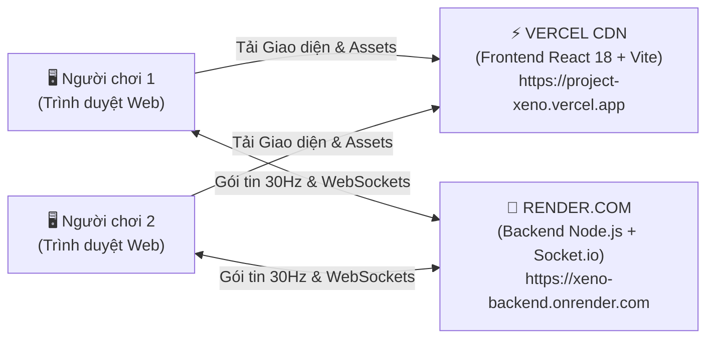

# 🌐 HƯỚNG DẪN TRIỂN KHAI ĐÁM MÂY (CLOUD DEPLOYMENT GUIDE)
## Project Xeno: Reloaded — Fullstack Edition (React 18 + Node.js Socket.io)

Tài liệu này hướng dẫn chi tiết từng bước đưa hệ thống game **Project Xeno: Reloaded** lên môi trường Internet toàn cầu với **chi phí 0đ (100% Miễn phí vĩnh viễn)** bằng sự kết hợp giữa **Vercel** (Frontend) và **Render.com** (Backend Socket.io).

---

## 🏗️ 1. MÔ HÌNH KIẾN TRÚC CLOUD



- **Frontend (Vercel Live)**:
  - Tên miền chính thức: **https://project-xeno-online.vercel.app**
  - Kho GitHub: **https://github.com/hoanganphatcctv-ctrl/project-xeno-online**
  - Phục vụ ứng dụng React 18, HTML5 Canvas và kho Asset âm thanh, đồ họa qua mạng CDN toàn cầu với độ trễ siêu thấp.
  - Tự động Build từ Git repository mỗi khi bạn push code mới.
- **Backend (Render.com)**:
  - Máy chủ Node.js chuyên dụng duy trì kết nối WebSocket thời gian thực (30Hz Packet Relay).
  - Quản lý danh sách phòng Co-op, mã PIN 6 ký tự và đồng bộ trạng thái gục ngã / cứu vô hạn lần.

---

## 🚀 2. BƯỚC 1: TRIỂN KHAI BACKEND LÊN RENDER.COM

Render cung cấp dịch vụ Web Service miễn phí có hỗ trợ đầy đủ WebSockets.

### Các bước thực hiện:
1. Đăng ký / Đăng nhập tài khoản miễn phí tại [Render.com](https://render.com).
2. Kết nối tài khoản GitHub chứa mã nguồn dự án của bạn.
3. Tại giao diện Render Dashboard, bấm **New +** ➔ Chọn **Web Service**.
4. Chọn kho mã nguồn (Repository) của bạn.
5. Điền các thông số cấu hình:
   - **Name**: `project-xeno-server` *(hoặc tên tùy chọn)*
   - **Region**: `Singapore (Southeast Asia)` *(để có ping thấp nhất cho người chơi Việt Nam & Châu Á)*
   - **Branch**: `main`
   - **Root Directory**: `alien-shooter-fullstack/backend` *(hoặc `backend` nếu repo của bạn bắt đầu từ thư mục này)*
   - **Runtime**: `Node`
   - **Build Command**: `npm install`
   - **Start Command**: `node server.js`
   - **Instance Type**: `Free`
6. Bấm nút **Create Web Service**.
7. Chờ 1 - 2 phút cho Render cài đặt dependencies và khởi chạy. Khi thấy log:
   ```text
   [SERVER] Project Xeno Dedicated Server running on port 4000
   ```
   Render sẽ cấp cho bạn một đường dẫn công khai, ví dụ:  
   👉 `https://project-xeno-server.onrender.com`
8. **Kiểm tra**: Mở đường dẫn trên trên trình duyệt, nếu thấy phản hồi JSON:
   ```json
   { "status": "online", "name": "Project Xeno Co-Op Game Server", "activeRooms": 0 }
   ```
   ➔ Backend của bạn đã sẵn sàng tiếp nhận kết nối!

---

## ⚡ 3. BƯỚC 2: TRIỂN KHAI FRONTEND LÊN VERCEL

Vercel là nền tảng tốt nhất để host ứng dụng Vite + React.

### Các bước thực hiện:
1. Đăng ký / Đăng nhập tài khoản tại [Vercel.com](https://vercel.com) (đăng nhập bằng GitHub).
2. Tại Vercel Dashboard, bấm **Add New...** ➔ Chọn **Project**.
3. Chọn Repository dự án của bạn và bấm **Import**.
4. Cấu hình Project:
   - **Framework Preset**: Chọn `Vite`.
   - **Root Directory**: Bấm Edit và chọn thư mục `alien-shooter-fullstack/frontend` *(hoặc `frontend`)*.
5. **Thêm biến môi trường (Environment Variables)**:
   - Mở mục **Environment Variables**.
   - Thêm biến sau:
     - **Key**: `VITE_BACKEND_URL`
     - **Value**: Dán URL backend Render bạn vừa tạo ở Bước 1 (Ví dụ: `https://project-xeno-server.onrender.com`).
6. Bấm **Deploy**.
7. Vercel sẽ tự động build ứng dụng trong khoảng 30-45 giây và cấp một tên miền miễn phí, ví dụ:  
   👉 `https://project-xeno-reloaded.vercel.app`

---

## 🎮 4. BƯỚC 3: KIỂM TRA TÁC CHIẾN ONLINE CO-OP 2 NGƯỜI

Sau khi hoàn tất 2 bước trên, bạn có thể gửi link chơi game cho bạn bè ở bất kỳ đâu:

1. **Người thứ nhất (Host)**:
   - Truy cập vào trang web Vercel.
   - Bấm **TÁC CHIẾN MẠNG (CO-OP 2 NGƯỜI)**.
   - Chọn tab **[1] TẠO PHÒNG (HOST)**.
   - Hệ thống sẽ sinh mã PIN 6 ký tự (Ví dụ: `XN8B92`) và Link mời trực tiếp (Ví dụ: `https://project-xeno.vercel.app/?room=XN8B92`).
   - Bấm nút **📋 SAO CHÉP MÃ** hoặc **🔗 SAO CHÉP LINK** gửi cho bạn bè.

2. **Người thứ hai (Client)**:
   - Cách A: Nhấp trực tiếp vào Link được gửi (`?room=XN8B92`) ➔ Game sẽ tự động nhận diện và kết nối ngay lập tức!
   - Cách B: Vào trang web ➔ Chọn tab **[2] VÀO PHÒNG (JOIN)** ➔ Dán mã `XN8B92` và bấm **KẾT NỐI**.

3. Khi cả 2 đã kết nối, Host bấm **BẮT ĐẦU CHIẾN DỊCH CO-OP** để cùng nhau xông vào trạm không gian tiêu diệt quái vật!

---

## 💡 5. MẸO TỐI ƯU HÓA: CHỐNG "NGỦ ĐÔNG" RENDER FREE TIER

Gói miễn phí của Render sẽ tạm dừng (sleep) dịch vụ sau 15 phút không có lượt truy cập (khiến lần truy cập tiếp theo mất khoảng 30s để khởi động lại).

**Cách khắc phục 100% miễn phí**:
1. Đăng ký tài khoản miễn phí tại [UptimeRobot.com](https://uptimerobot.com).
2. Bấm **Add New Monitor**.
   - **Monitor Type**: `HTTP(s)`
   - **Friendly Name**: `Xeno Backend Keepalive`
   - **URL (or IP)**: `https://project-xeno-server.onrender.com/health`
   - **Monitoring Interval**: `5 minutes`
3. Bấm **Create Monitor**.  
➔ UptimeRobot sẽ tự động gửi tín hiệu "ping" nhẹ nhàng tới máy chủ mỗi 5 phút, giữ cho máy chủ Socket.io của bạn luôn luôn thức 24/7 với 0ms thời gian chờ!

---

## 🛠️ 6. CHẠY VÀ KIỂM TRA THỬ NGHIỆM LOCAL (OFFLINE)

Nếu muốn chơi hoặc kiểm tra trên máy tính cá nhân qua mạng LAN / Wi-Fi gia đình:
1. Chạy file `install_dependencies.bat` để cài thư viện.
2. Chạy `start_backend.bat` (Cửa sổ 1 - Port 4000).
3. Chạy `start_frontend.bat` (Cửa sổ 2 - Port 5173).
4. Mở 2 tab trình duyệt tại `http://localhost:5173` để trải nghiệm đầy đủ tính năng Co-op 2 người với độ trễ 0ms!

