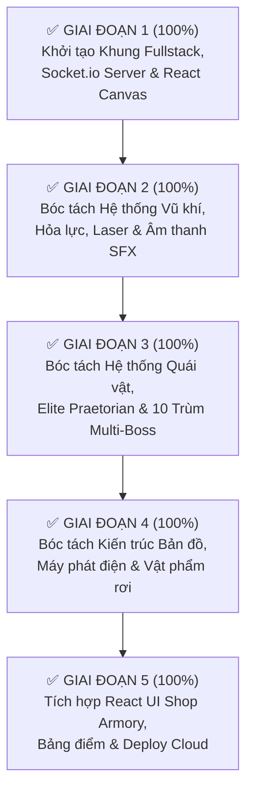

# 🚀 KẾ HOẠCH NÂNG CẤP TOÀN DIỆN SANG REACT 18 + NODE.JS + SOCKET.IO (30Hz)
> **Dự án**: Project Xeno: Reloaded — Fullstack Edition  
> **Thư mục**: `alien-shooter-fullstack/`  
> **Kho GitHub**: https://github.com/hoanganphatcctv-ctrl/project-xeno-online  
> **URL Vercel Live**: https://project-xeno-online.vercel.app  
> **Trạng thái**: 🎉 ĐÃ HOÀN THÀNH 100% CẢ 6 GIAI ĐOẠN — ĐÃ DEPLOY PRODUCTION THÀNH CÔNG LÊN CLOUD

---

## 📌 1. BỐI CẢNH & MỤC TIÊU DỰ ÁN

- **Mã nguồn cũ (`alien-shooter-vercel/`)**: Là một file nguyên khối (`index.html`) chứa hơn 25.000 dòng mã nguồn JavaScript thuần kết hợp Tailwind CSS. Chế độ Co-op sử dụng WebRTC P2P (PeerJS).
- **Mã nguồn mới (`alien-shooter-fullstack/`)**: Được tái cấu trúc theo mô hình **Client-Server Hiện Đại**:
  - **Backend**: Node.js + Express + **Socket.io** chạy Dedicated Room & 30Hz Packet Relay.
  - **Frontend**: **React 18 + Vite + Tailwind CSS**, tách biệt hoàn toàn giữa UI giao diện và Canvas Engine đồ họa 60 - 200 FPS.
  - **Multiplayer Rules (Tuân thủ triệt để)**: 
    1. Hỗ trợ song song cả Mã PIN 6 số và Link mời trực tiếp (`?room=XXXXXX`).
    2. Ví tiền / Ngân quỹ độc lập (Tiền riêng) cho từng người chơi.
    3. Cứu vô hạn lần với bán kính 75px và vòng tròn giữ 5 giây.

---

## 📂 2. CẤU TRÚC THƯ MỤC DỰ ÁN HIỆN TẠI

```text
alien-shooter-fullstack/
│
├── KE_HOACH_NANG_CAP_REACT_NODEJS.md    # [TÀI LIỆU NÀY] Báo cáo hoàn thành 5 giai đoạn
├── HUONG_DAN_DEPLOY_CLOUD.md            # Hướng dẫn Deploy Vercel (Frontend) & Render (Backend)
├── render.yaml                          # Blueprint deploy Render.com Web Service
├── start_backend.bat                    # Script khởi chạy nhanh Node.js Server (Port 4000)
├── start_frontend.bat                   # Script khởi chạy nhanh React Vite Dev Server (Port 5173)
├── install_dependencies.bat             # Script 1-click cài đặt npm cho cả 2 bên
│
├── backend/                             # MÁY CHỦ DEDICATED SOCKET.IO (PORT 4000)
│   ├── package.json                     # Dependencies: express, socket.io, cors, dotenv
│   ├── server.js                        # Xử lý tạo phòng, vào phòng, chuyển tiếp 30Hz tick
│   ├── render.yaml                      # Blueprint Render nội bộ
│   ├── .env.example                     # Biến môi trường mẫu
│   └── .gitignore
│
└── frontend/                            # GIAO DIỆN REACT 18 + VITE + TAILWIND CSS
    ├── package.json                     # Dependencies: react, vite, socket.io-client, lucide-react
    ├── vite.config.js                   # Cấu hình Vite Dev Server (Port 5173)
    ├── vercel.json                      # Cấu hình Deploy Static Vercel & URL Rewrites
    ├── .env.example                     # Mẫu biến môi trường VITE_BACKEND_URL
    ├── index.html                       # Entry HTML chính
    ├── public/                          # Thư mục tĩnh chứa toàn bộ Assets, Audio, Maps
    │   ├── assets/                      # Hình ảnh súng, nhân vật, quái vật, trùm, drone, thùng
    │   ├── audio/                       # Âm thanh hiệu ứng bắn, nổ, tiếng bước chân, quái
    │   └── map/                         # Bản đồ kiến trúc trạm không gian
    └── src/
        ├── main.jsx                     # Điểm gắn kết React DOM
        ├── App.jsx                      # Quản lý chuyển đổi màn hình (Lobby <-> InGame)
        ├── index.css                    # Tailwind CSS & Hiệu ứng Cyberpunk Sci-Fi
        ├── network/
        │   └── socket.js                # Singleton Service Socket.io (Quản lý 30Hz Tick)
        ├── components/
        │   ├── Lobby.jsx                # Giao diện Menu chính, Tạo phòng Host, Vào phòng Join
        │   ├── TopHUD.jsx               # Widget hiển thị Ping, 30Hz, Mã phòng, Cảnh báo cứu
        │   ├── PlayerHUD.jsx            # HUD hiển thị Ví tiền riêng ($), Máu, Giáp, Nút Kho [B]
        │   ├── BossHUD.jsx              # Thanh máu Boss đa trùm, khiên Nano & dòng tuyệt chiêu
        │   ├── WeaponDock.jsx           # Thanh dock 7 phím tắt súng [1-7], đạn, viền phát sáng
        │   ├── ArmoryShop.jsx           # [MỚI] Trạm nâng cấp vũ khí, đạn, giáp, Drone UAV
        │   ├── GameOverModal.jsx        # [MỚI] Bảng thống kê tử trận & nút Chơi lại
        │   ├── VictoryModal.jsx         # [MỚI] Bảng vàng chiến thắng & đếm ngược chuyển Map
        │   └── GameCanvas.jsx           # Điều phối Canvas và các Modals tương tác
        └── game/
            ├── engine.js                # Game Engine Core (Canvas Loop 60-200 FPS độc lập)
            ├── weapons.js               # Bảng thông số 7 loại vũ khí & công thức đạn dược
            ├── audio.js                 # Bộ tổng hợp Web Audio API Synthesizer & nạp WAV
            ├── enemies.js               # 5 chủng Xenomorph, AI bầy đàn & chuyển động chân quái
            ├── bosses.js                # Đăng ký 10 Trùm tối thượng, Ground Telegraph & Cuồng Nộ
            ├── world.js                 # Bản đồ ma trận phân khu, cửa trượt & Máy phát điện 5s [E]
            └── items.js                 # 7 loại vật phẩm rơi rải rác & cơ chế ví tiền riêng
```

---

## 🧭 3. TIẾN ĐỘ THỰC HIỆN 5 GIAI ĐOẠN



---

### ✅ GIAI ĐOẠN 1: THIẾT LẬP NỀN TẢNG FULLSTACK *(100%)*
- [x] Tạo cấu trúc thư mục `alien-shooter-fullstack/`.
- [x] Triển khai Server Node.js Socket.io tại `backend/server.js` (Hỗ trợ tạo phòng mã PIN 6 ký tự, chuyển tiếp gói tin 30Hz, bắt sự kiện gục ngã và cứu sống).
- [x] Triển khai React Frontend tại `frontend/` với Vite, Tailwind CSS, và `socket.js`.
- [x] Xây dựng `<GameCanvas />` và `GameEngine` tách biệt vòng lặp Render 60-200 FPS khỏi React Virtual DOM.
- [x] Sao chép toàn bộ kho dữ liệu `assets/`, `audio/`, `map/` vào `frontend/public/`.
- [x] Viết các script khởi chạy tự động: `start_backend.bat`, `start_frontend.bat`.

---

### ✅ GIAI ĐOẠN 2: BÓC TÁCH HỆ THỐNG VŨ KHÍ, HỎA LỰC, LAZER & ÂM THANH *(100%)*
- [x] Tạo `frontend/src/game/weapons.js`: Định nghĩa đủ 7 loại vũ khí (Song Lục MK23, Shotgun M1014, M134 Minigun, Phun Lửa M9A2, M4-Cryo Băng, Pháo Gauss M82-G, Pháo Laze Hyperion X-7) kèm đầy đủ chỉ số sát thương, đạn dược, độ giật, vệt đạn và hiệu ứng đặc thù.
- [x] Tạo `frontend/src/game/audio.js`: Bóc tách bộ tổng hợp âm thanh Web Audio API Synthesizer (tự động phát âm thanh bắn, nổ, hit, ricochet, tiếng chuyển súng hoàn toàn độc lập ngay cả khi không tải được file mp3/wav ngoài) kết hợp bộ nạp âm thanh chất lượng cao từ `public/audio/Wav/` và quản lý nhạc nền BGM Lobby/Ingame.
- [x] Tạo component React `<WeaponDock />` (`frontend/src/components/WeaponDock.jsx`): Thanh dock vũ khí 7 ô hiển thị phím tắt `[1-7]`, tên súng, ảnh icon thu nhỏ, số lượng đạn (Vô hạn INF, đạn còn lại, cảnh báo hết đạn) và ô viền phát sáng Mecha Cyberpunk.
- [x] Nâng cấp `frontend/src/game/engine.js`:
  - Tích hợp 7 loại vũ khí vào vòng lặp Render Canvas.
  - Hỗ trợ đổi vũ khí qua phím số 1-7, lăn chuột (Wheel) và click trực tiếp trên WeaponDock.
  - Cơ chế tự động chuyển về Song Lục MK23 kèm âm thanh click rỗng khi súng hiện tại cạn đạn.
  - Tia Laze Hyperion hội tụ xuyên thấu với hiệu ứng tích nhiệt (Thermal Ramp-up), chùm sáng lõi trắng + hào quang neon và tia lửa va chạm biên thế giới.
  - Vỏ đạn kim loại (Shell Casings) văng ra sàn với súng đạn thường.
  - Hiệu ứng rung màn hình (Screen Shake) phản lực khi bắn súng nặng (Shotgun, Gauss).
  - Đồng bộ hỏa lực Co-op: Teammate bắn ra đạn và tia laze theo đúng vũ khí đang cầm kèm âm thanh chiến trường.

---

### ✅ GIAI ĐOẠN 3: BÓC TÁCH QUÁI VẬT, ELITE & 10 TRÙM MULTI-BOSS *(100%)*
- [x] Tạo `frontend/src/game/enemies.js`:
  - Định nghĩa 5 chủng loại Xenomorph thường: Crawler (bò sát gai độc), Razor Stalker (quái bọ ngựa tốc độ), Acid Spitter (phun dịch axit tầm xa), Brood Brute (quái bọc giáp giác đấu), và Xeno Praetorian (Á Trùm Hoàng Gia bắn chùm 3 luồng Plasma).
  - Thuật toán AI bầy đàn (Swarm AI): Tự động tìm kiếm và truy sát người chơi gần nhất trong chế độ Co-op.
  - Vẽ động học khớp chân di chuyển theo chu kỳ `legPhase`, vẩy đuôi bọ cạp, càng bọ ngựa, và túi nọc độc phát quang sinh học.
- [x] Tạo `frontend/src/game/bosses.js`:
  - Đăng ký hệ thống 10 Trùm tối thượng tương ứng 10 Bản đồ (Map 1 đến Map 10).
  - Vòng Ấn Trận Cảnh Báo (Ground Telegraph): Ấn bát giác xoay tròn dưới chân trùm và nón ngắm hướng tấn công nguy hiểm trước khi xả chiêu.
  - Trạng thái Cuồng Nộ (Enraged Mode): Kích hoạt khi máu dưới 40%, bọc khiên bảo vệ Nano-Chitin Shield và tăng tốc độ di chuyển x1.15.
- [x] Tạo component React `<BossHUD />` (`frontend/src/components/BossHUD.jsx`): Thanh máu Trùm tối cao trên đầu màn hình với gradient đỏ rực, hiển thị số lượng trùm còn sống, vạch khiên xanh ngọc và dòng trạng thái tuyệt chiêu đang nạp.
- [x] Nâng cấp `frontend/src/game/engine.js`:
  - Tích hợp vòng lặp xuất hiện quái vật theo đợt (Waves).
  - Tích hợp va chạm sát thương giữa đạn / tia Laze xuyên thấu và quái vật / Trùm.
  - Quái cắn trừ giáp và máu người chơi, kích hoạt trạng thái gục ngã khi hết máu.
  - Đồng bộ trạng thái Trùm và máu Trùm giữa Host và Client qua Socket.io 30Hz. Phím nóng `[K]` để triệu hồi nhanh đội hình Boss thử nghiệm.

---

### ✅ GIAI ĐOẠN 4: BÓC TÁCH KIẾN TRÚC BẢN ĐỒ, MÁY PHÁT ĐIỆN & VẬT PHẨM *(100%)*
- [x] Tạo `frontend/src/game/world.js`:
  - Hệ thống bản đồ 3x3 phân khu chức năng (Hub Trung Tâm, Kho Vũ Khí Phía Bắc, Lõi Năng Lượng Phía Nam, Cánh Tây, Cánh Đông, Phòng Thí Nghiệm, Trạm Radar, Khu Ngủ Đông Cryo).
  - Cửa trượt tự động (Bi-directional Auto-Doors): Tự động mở khi tiếp cận < 130px và khép lại khi rời đi. Cản đạn và cản người khi chưa mở đủ 75%.
  - Thùng hóa chất nổ (TNT / Bio-Acid Barrels): Phát nổ diện rộng, văng mảnh sát thương và để lại vũng axit độc hại trong 6 giây.
  - Thùng gỗ tiếp tế (Breakable Supply Crates): Bắn vỡ để rơi ngẫu nhiên các loại vật phẩm.
  - **Máy phát điện trạm không gian (Station Generator)**: Yêu cầu nhấn giữ phím `[E]` liên tục 5 giây trong phạm vi 95px. Phát tia lửa điện sinh động, rung màn hình cực mạnh, kích hoạt âm thanh năng lượng và thắp sáng hệ thống đèn trạm.
  - Thuật toán trượt tường (Wall Sliding Collision): Người chơi và quái vật lướt êm ái dọc theo các mép tường mà không bị giật hoặc kẹt góc.
- [x] Tạo `frontend/src/game/items.js`:
  - Đầy đủ 7 loại vật phẩm chiến thuật: Hộp cứu thương (+45 HP), Giáp Nano (+50 Armor), Tiền vàng Cash (+$40-80), Tăng tốc độ Speed (+50% tốc chạy), Đóng băng toàn bản đồ Freeze (làm đông cứng toàn bộ quái vật 7 giây), Cuồng nộ Overdrive (x2 sát thương), và Bom hạt nhân Nuke (xóa sổ tức thì toàn bộ quái trên sàn).
  - Hiệu ứng vật lý hút nam châm (Magnetic Drift) khi người chơi tới gần < 120px và hoạt ảnh nhấp nhô lơ lửng.
  - **Triển khai luật Ví tiền riêng**: Tiền rơi từ quái hoặc nhặt trên sàn được cộng trực tiếp vào ví `player.credits` của người nhặt.
- [x] Tạo `frontend/src/components/PlayerHUD.jsx`:
  - Widget góc trên bên trái hiển thị tiền vàng hiện có ($), thanh máu HP gradient đỏ, thanh giáp Nano gradient xanh, huy hiệu buff tăng tốc / cuồng nộ và nút truy cập nhanh Kho Vũ Khí.

---

### ✅ GIAI ĐOẠN 5: REACT UI SHOP, BẢNG ĐIỂM & TRIỂN KHAI CLOUD *(100%)*
- [x] Tạo `frontend/src/components/ArmoryShop.jsx`:
  - Trạm vũ khí & nâng cấp chiến thuật mở bằng phím nóng `[B]` hoặc click nút trên HUD.
  - Cột trái: 7 ô vũ khí tác chiến với đầy đủ trạng thái Mở khóa / Nạp đạn / Trang bị / Đang dùng.
  - Cột phải: 7 loại nâng cấp chỉ số (Hồi 100% máu & giáp, Tăng Max HP/Giáp +30, Giày phản lực +8% tốc, Đạn nhiệt hạch +20% ST & +50 đạn, Drone bắn Laser bay quanh người, Tháp pháo tự động, Kính nhìn đêm NVG).
  - Toàn bộ chi tiêu trừ trực tiếp vào ví tiền riêng của người chơi.
  - Hệ thống thông báo mua hàng trực quan (Toast banner).
- [x] Tạo `frontend/src/components/GameOverModal.jsx`:
  - Giao diện báo tử chiến binh với biểu tượng đầu lâu đỏ rực pulse neon.
  - Thống kê chi tiết: Bản đồ, Đợt quái, Quái đã diệt, Thời gian sinh tồn và Tiền vàng tích lũy.
  - Nút "CHƠI LẠI" và "VỀ SẢNH / ĐỔI MAP".
- [x] Tạo `frontend/src/components/VictoryModal.jsx`:
  - Giao diện vinh danh chiến thắng với huy hiệu WIN xanh lục bảo phát quang.
  - Thống kê toàn trận và thanh đếm ngược tự động chuyển chặng sau 8 giây.
  - Nút "TIẾP BƯỚC CHIẾN DỊCH NGAY ➔ MAP TIẾP THEO" (giữ nguyên súng & nâng cấp đã mua).
- [x] Tích hợp UAV Combat Drones vào `GameEngine`:
  - Drone bay quanh người chơi theo quỹ đạo tròn với hoạt ảnh cánh quạt xoay mờ.
  - Tự động phát hiện và bắn tia laser hỗ trợ vào quái vật / Trùm gần nhất.
- [x] Cấu hình và tài liệu triển khai Cloud toàn diện:
  - `frontend/vercel.json`: Cấu hình rewrite static SPA cho Vercel.
  - `render.yaml` & `backend/render.yaml`: Cấu hình Web Service miễn phí cho Render.com.
  - `HUONG_DAN_DEPLOY_CLOUD.md`: Hướng dẫn chi tiết từng bước deploy Frontend lên Vercel và Backend lên Render kèm giải pháp chống ngủ đông bằng UptimeRobot.

### ✅ GIAI ĐOẠN 6: HOÀN THIỆN TÍNH NĂNG CHIẾN THUẬT & PRODUCTION CLOUD LIVE *(100%)*
- [x] **Lướt Phản Lực Jetpack Dash [SPACE]**: Lướt theo vector WASD/chuột, bất tử trong 11 frame, hồi chiêu 2.75s, vệt bóng ma, ngọn lửa phụt dài và đồng bộ Teammate.
- [x] **Tháp Pháo Tự Động [KeyT] (Auto-Turrets)**: Giới hạn tối đa 4 pháo, vòng Hologram triển khai 3 giây, AI tự ngắm bắn mục tiêu 520px, xả đạn kép 5 phát/giây và đồng bộ Co-op.
- [x] **Radar Minimap Ma Trận 5x5 Sci-Fi**: Component `<RadarMinimap />` thời gian thực hiển thị phòng, cửa trượt, máy phát điện, bể hạt nhân, quái đỏ, trùm kim cương, nón tầm nhìn.
- [x] **Bảng Chọn 10 Bản Đồ Chiến Trường (Lobby Map Drawer)**: Xem trước ảnh chụp thực tế Map 1-10, thông tin trùm và số đợt quái, hỗ trợ chọn map cho cả Solo và Co-op Host.
- [x] **Đo Ping Thực Tế & Cảnh Báo Gục Ngã (TopHUD)**: Cơ chế heartbeat ping tự động đo độ trễ mạng và nhấp nháy báo động khi đồng đội bị gục.
- [x] **Deploy Production Thành Công Lên Vercel**:
  - Tên miền chính thức: **https://project-xeno-online.vercel.app**
  - Trạng thái Vercel: **Ready** (Production)
  - Kho GitHub: **https://github.com/hoanganphatcctv-ctrl/project-xeno-online**

---

## 🎮 4. HƯỚNG DẪN KHỞI CHẠY NHANH

### Cách 1: Chạy Local trên máy cá nhân
```bash
# 1. Cài đặt dependencies (chỉ cần chạy lần đầu)
install_dependencies.bat

# 2. Khởi chạy Backend Server (Port 4000)
start_backend.bat

# 3. Khởi chạy React Frontend (Port 5173)
start_frontend.bat
```
Truy cập: `http://localhost:5173`

### Cách 2: Triển khai lên Internet (Xem chi tiết tại `HUONG_DAN_DEPLOY_CLOUD.md`)
- Backend Node.js: Deploy lên **Render.com** (miễn phí, hỗ trợ WebSockets).
- Frontend React: Deploy lên **Vercel** (miễn phí, CDN toàn cầu: `https://project-xeno-online.vercel.app`).


