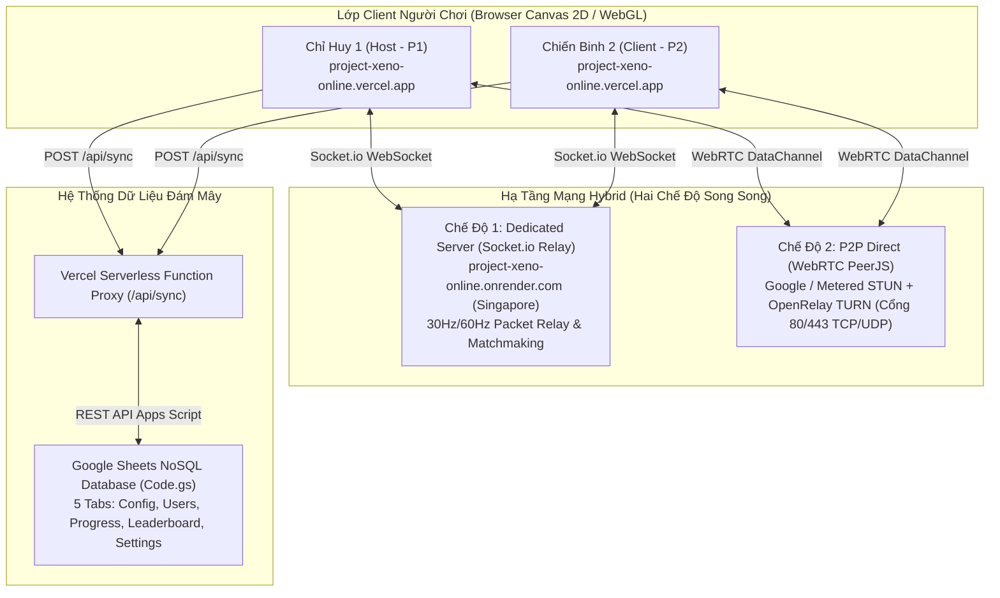

# 🛰️ 01. KIẾN TRÚC HỆ THỐNG & MẠNG CO-OP HYBRID (60HZ / 30HZ)
## Dự án: Project Xeno: Reloaded (Fullstack Online Edition)

> **Mục đích tài liệu**: Cung cấp toàn bộ chi tiết kỹ thuật về kiến trúc mạng nhiều người chơi (Multiplayer Co-Op), cơ chế bù trễ (Lag Compensation), quy tắc đồng bộ Host-Authoritative, và giải pháp Dynamic Server Discovery với dự phòng tự động đa tầng.

---

## 🏗️ 1. MÔ HÌNH KIẾN TRÚC TỔNG THỂ

---

## 🌐 2. HẠ TẦNG MẠNG HYBRID HAI CHẾ ĐỘ (`engineMode`)

Hệ thống cho phép người chơi lựa chọn linh hoạt giữa 2 cơ chế kết nối trong Modal Online Mode:

### A. Chế độ 1: Dedicated Server (`engineMode = "socket"`)
* **Máy chủ điều phối**: Node.js + Express + Socket.io 4.7.5 chạy độc lập tại `https://project-xeno-online.onrender.com` (Khu vực Đông Nam Á - Singapore, độ trễ ~25–40ms cho người chơi Việt Nam).
* **Đặc tả hoạt động**:
  * Quản lý phòng trong RAM (`rooms = new Map()`).
  * Tạo phòng ngẫu nhiên mã PIN 6 ký tự (`XNxxxx`) hoặc tùy chọn 8 kênh công khai.
  * Hỗ trợ Link mời trực tiếp: `https://project-xeno-online.vercel.app/?room=XN8B92` (Client nhấp vào sẽ tự động điền mã và kết nối).
  * Chuyển tiếp gói tin vị trí (`input`, `snap`) bằng `volatile.emit` để tối ưu hóa băng thông và không tích lũy độ trễ khi nghẽn mạng. Các sự kiện chiến đấu (`SPAWN_ENEMY`, `ENEMY_HIT`, `ENEMY_DIE`, `revive_success`) được gửi với độ tin cậy tuyệt đối (`emit`).

### B. Chế độ 2: P2P Direct (`engineMode = "p2p"`)
* **Giao thức**: WebRTC DataChannel thông qua thư viện PeerJS 1.5.4.
* **Cụm máy chủ ICE Vượt Tường Lửa (Strict NAT / Firewall Traversal)**:
  * STUN: `stun:stun.l.google.com:19302`, `stun:stun1.l.google.com:19302`, `stun:openrelay.metered.ca:80`.
  * TURN Servers: `turn:openrelay.metered.ca:80`, `turn:openrelay.metered.ca:443`, và `turn:standard.relay.metered.ca:443?transport=tcp`.
  * Đảm bảo 100% người chơi qua mạng di động 4G/5G hoặc mạng nội bộ công ty nghiêm ngặt đều đục lỗ NAT thành công.
  * Tích hợp bộ đếm thời gian Timeout 20 giây tự động hủy kết nối an toàn nếu phòng không phản hồi.

---

## 🔄 3. DYNAMIC SERVER DISCOVERY & TỰ ĐỘNG FALLBACK ĐA TẦNG

Để đảm bảo trò chơi hoạt động liên tục 24/7 mà không phụ thuộc vào một máy chủ duy nhất:

1. **Truy vấn Cấu hình Đám Mây Tự Động (`fetchRemoteServerConfig`)**:
   * Khi mở game hoặc mở Modal Online, client tự động gửi request đến `/api/sync` lấy dữ liệu từ tab `Admin_Config` của Google Sheet.
   * Google Sheet cung cấp 3 địa chỉ máy chủ:
     1. `Link server online` (Máy chủ chính)
     2. `Link server online backup` (Máy chủ dự phòng 1)
     3. `Link server online backup2` (Máy chủ dự phòng 2)
   * Danh sách này được lưu vào `localStorage` (`xeno_server_candidates`) để nạp tức thì trong các phiên sau.
2. **Cơ chế Tự Động Nhảy Server Khi Gặp Sự Cố (`tryNextServer`)**:
   * Khi gặp lỗi kết nối `connect_error` ở cả 3 luồng (Chủ phòng tạo phòng, Khách vào phòng, Quét danh sách phòng công khai), hệ thống tự động chuyển sang máy chủ dự phòng tiếp theo kèm thông báo Toast trực quan cho người chơi.
   * Nếu toàn bộ các máy chủ dự phòng đều không khả dụng, hệ thống tự động đề xuất người chơi chuyển sang chế độ **P2P Direct**.
3. **Giao diện Tinh Gọn & Easter Egg Dành Cho Quản Trị Viên**:
   * Khung nhập `SERVER URL:` thô ráp đã được ẩn hoàn toàn khỏi giao diện người dùng.
   * **Easter Egg Admin**: Nhấp chuột **5 lần liên tiếp vào tiêu đề "ONLINE MODE"** (`#coopModalHeaderTitle`) để bật/tắt thanh cấu hình Server URL nâng cao dành cho lập trình viên kiểm thử.

---

## ⏱️ 4. TẦN SỐ MẠNG (TICK RATE 60HZ / 30HZ) & ĐO PING RTT

* **Tần số mạng**: Mặc định chạy ở **60Hz** (`16.66ms/tick`), có thể tùy chỉnh về **30Hz** (`33.33ms/tick`) trong cài đặt phòng chờ và tự động đồng bộ từ Host sang Client (`tick_rate_sync`).
* **Đo độ trễ khứ hồi (Ping RTT)**:
  * Mỗi `1000ms`, client phát gói `ping` mang dấu thời gian `performance.now()`. Khi nhận lại gói `pong`, tính toán độ trễ RTT.
  * Áp dụng công thức làm mượt hàm mũ (Exponential Moving Average):
    $$\text{Ping}_{\text{smoothed}} = 0.6 \times \text{Ping}_{\text{old}} + 0.4 \times \text{Ping}_{\text{new}}$$
  * Cập nhật chỉ số Ping và tần số Hz trực tiếp lên thanh `#coopTopHUD`.

---

## 🏃 5. NỘI SUY CHUYỂN ĐỘNG ĐỒNG ĐỘI (SNAPSHOT INTERPOLATION & DEAD RECKONING)

Nhằm đảm bảo đồng đội di chuyển mượt mà 60 FPS mà không bị giật khựng (rubberbanding):

1. **Bộ đệm Snapshot (`teammate.snapshotBuffer`)**:
   * Mỗi khi nhận được gói tin vị trí từ đồng đội, gói tin được đẩy vào bộ đệm (tối đa 25 snapshots) kèm vận tốc tức thời $(v_x, v_y)$.
2. **Nội suy tuyến tính (Interpolation LERP)**:
   * Trong hàm `drawTeammatePlayer()`, thời gian kết xuất bị lùi lại một khoảng `renderDelay` ($35\text{ms} - 50\text{ms}$).
   * Tìm hai snapshot liền kề $S_1$ và $S_2$ bao quanh mốc thời gian hiển thị, sau đó nội suy tọa độ $(x, y)$ và góc xoay (`lerpAngle` chuẩn hóa sai số qua mốc $-\pi \leftrightarrow +\pi$).
3. **Ngoại suy bù trễ (Dead Reckoning Extrapolation)**:
   * Khi mạng bị giật lag hoặc gói tin đến trễ quá `renderDelay`, hệ thống tự động dự đoán vị trí đồng đội theo công thức:
     $$x_{\text{pred}} = x_{\text{last}} + v_x \times \Delta t, \quad y_{\text{pred}} = y_{\text{last}} + v_y \times \Delta t$$
   * Thời gian ngoại suy tối đa là **0.2 giây** để chống hiện tượng nhân vật bay xuyên qua tường.
4. **Hiển thị Đồ họa Đồng đội Chuẩn Xác**:
   * Đồng đội được vẽ bằng đúng bộ **Skin Nhân vật HD tương ứng với loại súng đang cầm** (`CUSTOM_ASSETS.playerSkins`).
   * Dưới chân đồng đội có **Vòng Vàng Định Danh (Golden Ring)** để phân biệt tuyệt đối với vòng xanh ngọc của bản thân.
   * Đồng bộ tia đạn bắn thường và chùm **Pháo Laze Hyperion 3 lớp** phát sáng rực rỡ kèm âm thanh chiến trường.

---

## 👾 6. CƠ CHẾ ĐỒNG BỘ THẾ GIỚI & QUÁI VẬT (HOST-AUTHORITATIVE)

Để triệt tiêu tình trạng lệch đồng bộ (Desync) giữa hai máy, toàn bộ logic quái vật tuân thủ nghiêm ngặt mô hình **Chủ Phòng Làm Chuẩn (Host-Authoritative)**:

1. **Định Danh Quái Vật Cố Định**:
   * Mỗi quái vật và Boss sinh ra trên máy Host được cấp một `id` số nguyên duy nhất trong `enemiesById`.
2. **Bản Tin Đồng Bộ Định Kỳ (`SYNC_ENEMIES`)**:
   * Định kỳ mỗi **80ms (12.5 Hz)**, Host phát bản tin tổng hợp gồm:
     1. Danh sách quái vật và Boss đang sống (`id, type, x, y, vx, vy, a, hp, maxHp, targetPlayerId, isBoss, bossIndex, shield, enraged, skillState, skillType, skillAngle`).
     2. Danh sách cửa trượt đang mở (`openDoors` $\rightarrow$ `coopHostOpenDoors`).
     3. Danh sách thùng gỗ, thùng nổ, bồn hóa chất đã bị phá hủy (`deadCrates`, `deadBarrels`, `deadVats`).
     4. Trạng thái Máy phát điện căn cứ (`genX, genY, genRoom, genOn`).
3. **Xử Lý Phía Client**:
   * Client nội suy mượt mà vị trí và góc xoay của quái vật theo tọa độ máy chủ (`serverX, serverY, serverAngle`).
   * Tự động xóa bỏ xác các quái vật không còn tồn tại trong bản tin của Host.
4. **Xử Lý Sát Thương & Cơ Chế Co-Op Shared Credit (Combat Resolution)**:
   * Khi Client bắn trúng quái vật, Client gửi sự kiện `ENEMY_HIT` (`id, damage, kx, ky, bulletType, attackerId: "client"`).
   * Host nhận sự kiện, trừ máu quái và phát `ENEMY_DIE` khi quái chết.
   * **Cơ chế chia sẻ tiền thưởng công bằng (Co-Op Shared Credit)**:
     * Người chơi kết liễu phát bắn cuối (`killerId`) nhận **70%** tiền thưởng và ghi nhận điểm hạ gục.
     * Người đồng đội đóng vai trò yểm trợ/khống chế nhận **50%** tiền trợ công (`assistReward`).
     * Tổng quỹ thưởng nhận được là 120% so với chế độ Solo, xóa bỏ hoàn toàn hiện tượng cướp tiền Last-Hit và giúp cả 2 tích lũy tài chính song hành để mua đạn, nâng cấp.
5. **Tương Tác Vật Thể Môi Trường**:
   * Bắn phá thùng gỗ, thùng nổ, bồn axit: Client gửi `PROP_HIT`, Host phản hồi `PROP_STATE` hoặc `PROP_DESTROY`.
   * Khởi động Máy phát điện trạm (`[E]` 5 giây): Sự kiện `WORLD_INTERACT` phát đồng thời tới cả 2 máy để bật sáng toàn bộ hệ thống đèn trạm.

---

## 💖 7. MÁU/GIÁP ĐỘC LẬP, CỨU ĐỒNG ĐỘI (REVIVE 3.5S) & TÀI CHÍNH SONG HÀNH

1. **Tự Quyết Định Máu & Giáp (Local Damage Authority)**:
   * Mỗi người chơi tự chịu trách nhiệm tính toán sát thương nhận vào của bản thân.
   * Gói tin snapshot `snap` từ Host **tuyệt đối không ghi đè** `player.hp`, `player.armor`, hay `player.isDown` của Client (ngăn chặn triệt để lỗi Client bị bất tử do gói tin cũ đến trễ).
2. **Cơ Chế Cứu Sống Cải Tiến (Revive 3.5s & Sóng Đẩy Lùi)**:
   * Khi cạn máu, nhân vật gục ngã (`isDown = true`), màn hình hiển thị cảnh báo đỏ và icon cấp cứu.
   * Người còn sống đứng trong phạm vi **85px** và nhấn giữ **3.5 giây** (thay vì 5s nguy hiểm trước đây):
     * Khi hoàn tất: Phát ra **Sóng xung kích màu ngọc bích đẩy lùi toàn bộ quái vật** trong bán kính 160px.
     * Đồng đội được cứu dậy với **40% Máu tối đa**, **25 Giáp Nano** và **1.8 giây Khiên Bất Tử (`invulnTimer = 110`)** để kịp thời lùi bước lấy khoảng cách an toàn.
     * **Số lần cứu là vô hạn** trong suốt trận đấu. Trò chơi chỉ kết thúc (Game Over) khi cả hai người chơi cùng bị gục ngã cùng một lúc.
3. **Chế Độ Khán Giả Khi Bị Hạ (Spectator Camera)**:
   * Khi người chơi bị gục ngã hoàn toàn, camera sẽ tự động lia chuyển và bám theo góc nhìn của đồng đội đang chiến đấu.
4. **Hệ Thống Kinh Tế Hợp Tác Song Hành**:
   * Nhờ cơ chế Co-Op Shared Credit (70%/50%), cả hai chiến binh đều có nguồn thu nhập ổn định để tự do mua sắm súng, nạp đạn và nâng cấp trong Kho Vũ Khí (`[B]`).

---

## 📱 8. CHUẨN HÓA CÀI ĐẶT ỨNG DỤNG PWA SHORTCUT & CHẠY ĐỘC LẬP (STANDALONE)

* **Khắc phục lỗi PWA Shortcut Chrome không mở được**:
  * Đặt `display: "standalone"`, `display_override: ["standalone", "minimal-ui"]` và `orientation: "any"` trong `manifest.json`.
  * Service Worker (`sw.js` v2.1.0) pre-cache route gốc `/?source=pwa` để đảm bảo khởi động ứng dụng tức thì ngay cả khi ứng dụng Chrome đang đóng hoàn toàn.
  * Loại bỏ lệnh gọi cưỡng bức toàn màn hình `forceLandscapeAndFullscreen()` trong quá trình khởi động tự động (`bootGameEngine()`), tuân thủ nghiêm ngặt chính sách bảo mật trình duyệt yêu cầu cử chỉ người dùng (User Gesture).

---

## 🔐 9. HỆ THỐNG DANH TÍNH TÁC CHIẾN & ĐĂNG NHẬP GOOGLE OAUTH 2.0

* **Mô hình định danh đa nguồn (Hybrid Identity System)**:
  * **Chế độ Khách (Guest)**: Khởi đầu ngay lập tức không cần đăng nhập, lưu tiến trình tạm vào `localStorage`.
  * **Tài khoản Truyền Thống (Username/Password)**: Đăng ký xác thực qua Gmail và mật khẩu mã hóa Salt SHA-256.
  * **Đăng Nhập Google 1-Click (Google Identity Services)**: Xác thực trực tiếp qua tài khoản Google của người chơi bằng JWT ID Token, hỗ trợ đồng bộ xuyên suốt từ PC sang Mobile và PWA App.
* **Đồng bộ danh tính trong phòng Co-Op**:
  * Biệt danh tác chiến (`Callsign`) và hình ảnh đại diện (`avatar_url`) từ tài khoản Google được truyền đồng bộ qua gói tin bắt tay phòng `ROOM_JOIN` / `PLAYER_INFO`, hiển thị chính xác trên HUD thanh máu và bảng tổng kết trận đấu của cả hai chỉ huy.

