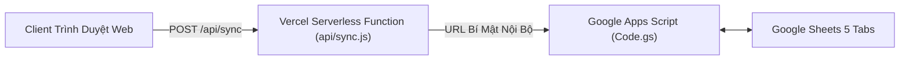

# 💎 04. QUY CHUẨN ASSET & HỆ THỐNG CLOUD DATABASE
## Dự án: Project Xeno: Reloaded (Fullstack Online Edition)

> **Mục đích tài liệu**: Định nghĩa chi tiết danh mục tài nguyên đồ họa & âm thanh của trò chơi, cơ chế nạp an toàn Graceful Fallback, và kiến trúc cơ sở dữ liệu đám mây Google Sheets kết hợp Vercel Serverless Proxy.

---

## 🎨 1. QUY CHUẨN ĐẶT TÊN & DANH MỤC ASSETS

Toàn bộ file hình ảnh PNG trong suốt được lưu trữ đồng bộ tại thư mục:  
👉 `alien-shooter-fullstack/frontend/assets/`

### A. Icon Vũ Khí (HUD Dock & Armory Shop) — PNG 256x256 / 512x256
| Slot | Tên Vũ Khí | Tên File Chính | Tên File Phụ (Alt) |
| :---: | :--- | :--- | :--- |
| **1** | Song Lục Tác Chiến MK23 | `01_gun.png` | `weapon_01.png` |
| **2** | Shotgun Chiến Thuật M1014 | `short_gun02.png` | `weapon_02.png` |
| **3** | Súng Máy Minigun M134 | `gatling_gun03.png` | `weapon_03.png` |
| **4** | Súng Phun Lửa M9A2 | `fire_gun04.png` | `weapon_04.png` |
| **5** | Súng Trường Băng M4-Cryo | `sung_bang05.png` | `weapon_05.png` |
| **6** | Đại Bác Cao Tần Gauss M82 | `phao-06.png` | `weapon_06.png` |
| **7** | Pháo Laze Tập Trung Hyperion X-7 | `laze_gun07.png` | `weapon_07.png` |

### B. Skin Nhân Vật Tương Ứng Từng Khẩu Súng (Cho P1 & Đồng Đội P2)
| Vũ Khí Đang Cầm | Tên File Chính | Mô Tả Trực Quan |
| :--- | :--- | :--- |
| Cầm Súng Lục (Slot 1) | `sung_luc.png` | Chiến binh cầm 2 tay 2 khẩu MK23 |
| Cầm Shotgun (Slot 2) | `short_gun.png` | Chiến binh báng súng tì vai |
| Cầm Minigun (Slot 3) | `gatling_gun.png` | Chiến binh vác súng máy 6 nòng hạng nặng |
| Cầm Phun Lửa (Slot 4) | `fire_gun.png` | Chiến binh đeo bình napalm sau lưng |
| Cầm Súng Băng (Slot 5) | `sung_bang.png` | Chiến binh cầm súng trường năng lượng hàn băng |
| Cầm Pháo Gauss (Slot 6) | `phao.png` | Chiến binh vác khẩu đại bác cao tần Gauss |
| Cầm Pháo Laze (Slot 7) | `laze_gun.png` | Chiến binh mang súng phóng chùm laze Hyperion |

### C. Đơn Vị Tác Chiến & Đồ Vật Môi Trường
| Đơn Vị / Vật Thể | Tên File | Mô Tả Kỹ Thuật |
| :--- | :--- | :--- |
| **Tháp Pháo Tự Động** | `phao_tu_dong.png` | Tỉ lệ chuẩn hóa: `pivotXRatio: 0.443`, `pivotYRatio: 0.50`, `baseDiameterRatio: 0.50` |
| **Drone UAV Hỗ Trợ** | `drone.png` | Drone 4 cánh quạt bay tuần tra quanh nhân vật |
| **Kén Ngủ Đông 1 & 2** | `ken_ngudong.png`<br>`ken_ngudong2.png` | Kén sinh học `433x577`, pre-bake hào quang phát quang VRAM |
| **Máy Gia Tốc Hạt** | `may_gia_toc.png` | Kích thước `560x167`, tự động xoay ngang/dọc, vẽ tia sét và hạt photon |
| **Máy Phát Điện** | `generator.png` | Trạm phát điện trung tâm, sạc 5s bằng phím `[E]` |
| **Thùng Gỗ Quân Sự** | `crate.png` | Bắn vỡ rơi ra tiền hoặc trang bị |
| **Thùng Nhiên Liệu Nổ** | `barrel_tnt.png`<br>`barrel_acid.png`<br>`barrel_cryo.png`<br>`barrel_oil.png` | 4 loại thùng nổ (Thuốc nổ, Axit, Băng giá, Dầu loang) |

### D. Vật Phẩm Rơi Trong Trận (Drops) & UI
* **Vật phẩm**: `hp.png` (Máu), `tang_mau_giap.png` (Giáp), `tang_toc_chay.png` (Tốc chạy), `tang_dame.png` (Đạn nhiệt hạch), `kinh_dem.png` (Kính nhìn đêm NVG), `item_cash.png` (Tiền), `item_freeze.png` (Đóng băng), `item_nuke.png` (Bom hạt nhân), `ammo` (Hộp tiếp tế đạn dược vàng hổ phách).
* **Giao diện**: `load_game.png` (Ảnh nạp trận), `spaceport.png` (Hình nền sảnh chờ), `lobby_bg.png` (Nền căn cứ).
* **Bản đồ**: `alien-shooter-fullstack/frontend/map/map_01.png` đến `map_10.png`.
* **Âm thanh**: `alien-shooter-fullstack/frontend/audio/` (`nhac_nen.ogg`, `ingame.mp3`, thư mục `Wav/`).

### E. Cơ Chế Dự Phòng An Toàn (Safe Graceful Fallback)
Toàn bộ mã nguồn nạp asset được lập trình theo tiêu chuẩn **Zero-Crash**:
* Nếu file ảnh **tồn tại**: Game hiển thị hình ảnh HD sắc nét.
* Nếu file ảnh **thiếu hoặc bị lỗi mạng**: Game tự động chuyển sang đồ họa Vector Canvas thuần túy, **không gây vỡ giao diện, không báo lỗi console và không làm dừng game**.

---

## ☁️ 2. HỆ THỐNG CLOUD DATABASE (GOOGLE SHEETS + APPS SCRIPT)

Trò chơi sử dụng Google Sheets làm cơ sở dữ liệu đám mây NoSQL miễn phí, ổn định cao và không giới hạn lượt truy cập thông qua Google Apps Script (`google-sheets-backend/Code.gs`).

### 5 Tab Dữ Liệu Trong Database:
1. **`Admin_Config`**: Cấu hình toàn hệ thống:
   * `admin_email`: Email nhận yêu cầu khôi phục mật khẩu.
   * `starting_credits`: Quỹ tiền tân thủ mặc định ($120).
   * `Link server online`: Đường dẫn máy chủ Socket.io chính thức.
   * `Link server online backup` & `backup2`: Máy chủ dự phòng 1 và 2 cho cơ chế tự động Fallback.
   * `google_client_id`: OAuth 2.0 Client ID xác thực đăng nhập nhanh bằng tài khoản Google.
2. **`Users`**: Danh sách tài khoản:
   * Mật khẩu được mã hóa an toàn bằng thuật toán **SHA-256 kèm chuỗi Salt ngẫu nhiên**.
   * Quản lý `session_token`, thời điểm đăng nhập cuối và trạng thái reset mật khẩu.
3. **`Progress`**: Tiến trình chiến dịch:
   * Lưu trữ `user_id`, `max_unlocked_map` (1-10), số dư `credits`, cấp độ nâng cấp máu/giáp/tốc độ/sát thương/drone, và danh sách vũ khí đã mở khóa.
4. **`Leaderboard`**: Bảng vinh danh Top 20 toàn cầu:
   * Xếp hạng theo Map cao nhất, số quái đã diệt, thời gian sinh tồn và tổng số chiến thắng.
5. **`Settings`**: Tùy chỉnh cá nhân:
   * Lưu ảnh đại diện `avatar_url`, hình nền sảnh `lobby_bg_url`, độ mờ nền `lobby_dim`, và giới hạn FPS.

---

## 🛡️ 3. LỚP BẢO MẬT & VERCEL SERVERLESS PROXY



1. **Vercel Serverless Proxy (`api/sync.js`)**:
   * Toàn bộ các yêu cầu từ Client được chuyển qua endpoint `/api/sync`.
   * **URL Google Apps Script được giấu kín hoàn toàn** trong biến môi trường máy chủ Vercel (`XENO_CLOUD_API_URL`), ngăn chặn kẻ xấu lấy được link trực tiếp để spam hoặc tấn công DoS database.
2. **Triệt Tiêu Lỗ Hổng Stored XSS**:
   * Mọi dữ liệu do người dùng nhập (`displayName`, tên người chơi trên Bảng xếp hạng, thông báo hệ thống) đều bắt buộc đi qua hàm làm sạch:
     ```javascript
     function escapeHtml(str) {
         if (!str) return "";
         return String(str)
             .replace(/&/g, "&amp;")
             .replace(/</g, "&lt;")
             .replace(/>/g, "&gt;")
             .replace(/"/g, "&quot;")
             .replace(/'/g, "&#039;");
     }
     ```
3. **Giới Hạn Bộ Nhớ LocalStorage Tránh Lỗi Quota**:
   * Ảnh nền sảnh chờ tải lên được tự động nén xuống tối đa $1280 \times 720\text{ px}$ (chất lượng JPEG 0.75).
   * Ảnh đại diện Avatar được nén xuống $256 \times 256\text{ px}$ (chất lượng JPEG 0.82), bọc trong khối `try/catch` có toast thông báo thân thiện nếu bộ nhớ trình duyệt bị đầy.
4. **Kiểm Tra Hợp Lệ Gói Tin Mạng (Input Clamping)**:
   * Gói tin `ENEMY_HIT` trên Host giới hạn sát thương tối đa không quá 2,500 damage/viên đạn, lực đẩy `kx/ky` trong đoạn $[-40, +40]$.
   * Gói tin `input` giới hạn chỉ số máu và giáp tối đa 5,000, ngăn chặn việc chỉnh sửa bộ nhớ (Memory Hack) trên Client để bất tử hoặc one-hit Boss trong chế độ Co-Op.
5. **Subresource Integrity (SRI) Trên CDN**:
   * Thư viện PeerJS 1.5.4 và Socket.io 4.7.5 được bảo vệ bằng mã băm `sha384-...` và thuộc tính `crossorigin="anonymous"`.
   * **Lưu ý đặc biệt**: Tuyệt đối **không** gắn `crossorigin="anonymous"` vào `https://cdn.tailwindcss.com` vì CDN này redirect 302 không trả header CORS, sẽ làm trình duyệt chặn nạp CSS và làm vỡ toàn bộ giao diện.

---

## 🔐 4. HỆ THỐNG XÁC THỰC GOOGLE OAUTH 2.0 (GOOGLE IDENTITY SERVICES)

Trò chơi hỗ trợ đăng nhập 1-chạm thông qua **Google Identity Services (GIS)** kết hợp cơ sở dữ liệu Google Sheet:

1. **Luồng Xác Thực Kỹ Thuật (`LOGIN_GOOGLE`)**:
   * **Frontend**: Tải thư viện chính chủ `<script src="https://accounts.google.com/gsi/client" async defer></script>`, khởi tạo với `client_id` (đọc động từ tab `Admin_Config` của Sheet hoặc fallback mặc định).
   * **Xác minh bảo mật**: Token định danh JWT (Credential) được gửi về Apps Script (`Code.gs`) và xác thực trực tiếp qua Google TokenInfo API (`https://oauth2.googleapis.com/tokeninfo?id_token=...`).
2. **Cơ Chế Liên Kết & Tạo Tài Khoản Tự Động (Smart Linking)**:
   * **Tài khoản đã tồn tại**: Nhận diện theo Gmail trong tab `Users`, đăng nhập tức thì, cấp `session_token` mới, đồng bộ tiền tệ, map và súng đã mở khóa. Nếu tài khoản chưa có avatar, tự động lấy ảnh profile từ Google làm Avatar.
   * **Người chơi mới**: Tự động tạo bản ghi trong 3 tab `Users`, `Progress`, `Settings` với `$120` khởi đầu, mở khóa Map 1, và dùng ảnh Google làm Avatar.
3. **Cơ Chế Dự Phòng An Toàn (Graceful Fallback)**:
   * Khi mở file trực tiếp từ ổ cứng (`file:///...`), hệ thống tự động ẩn nút Google để tuân thủ chính sách bảo mật của Google OAuth, đồng thời giữ nguyên 100% chức năng Đăng ký / Đăng nhập Username & Password truyền thống.

