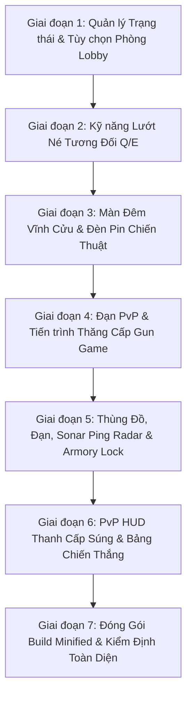

# 🎯 07. KẾ HOẠCH & TIẾN ĐỘ TRIỂN KHAI CHẾ ĐỘ SOLO 1V1 PVP GUN GAME (BÓNG TỐI & LƯỚT Q/E)
## Dự án: Project Xeno: Reloaded (Fullstack Online Edition)
## Đặc tả chế độ: Đấu Trường Đêm Tối • Lướt Chiến Thuật Q/E • Gun Game 7 Cấp Độ • Radar Sonar Ping

---

## 📌 1. TỔNG QUAN Ý TƯỞNG & QUY TẮC GAMEPLAY

1. **Môi Trường & Tầm Nhìn**:
   * Không có điện trạm (`mapGenerator.active = false`). Màn đêm bao phủ $94\%$ toàn map.
   * Mỗi người chơi chỉ có quầng hào quang thân $120\text{ px}$ và nón đèn pin $580\text{ px}$ quét góc $50^\circ$ theo hướng chuột.
   * Đối thủ chỉ nhìn thấy được khi: lọt vào chùm đèn pin, hoặc khi đối thủ nổ súng tạo chớp lửa nòng súng (Muzzle Flash).
2. **Kỹ Năng Lướt Né Tương Đối (`Q` / `E`)**:
   * Phím `Q`: Lướt né sang **TRÁI** vuông góc với góc nòng súng ($\theta - 90^\circ$).
   * Phím `E`: Lướt né sang **PHẢI** vuông góc với góc nòng súng ($\theta + 90^\circ$).
   * Tốc độ: $15.5\text{ px/tick}$, thời gian $11\text{ ticks}$, cooldown $1.4\text{s}$.
3. **Tiến Trình Gun Game (7 Cấp Vũ Khí)**:
   * Cấp 1: Song Lục MK23 (khởi đầu, đạn vô hạn)
   * Cấp 2: Shotgun M1014 (cận chiến đạn chùm)
   * Cấp 3: M134 Minigun (súng máy liên thanh)
   * Cấp 4: Phun Lửa M9A2 (thiêu đốt tầm trung)
   * Cấp 5: M4-Cryo Băng (làm chậm tốc độ chạy)
   * Cấp 6: Pháo Gauss M82-G (bắn tỉa công phá cao)
   * Cấp 7: Pháo Laze Hyperion X-7 (chùm tia hội tụ xuyên thấu) -> **HẠ ĐỐI THỦ LÀ CHIẾN THẮNG CHUNG CUỘC!**
4. **Cân Bằng Sát Thương (PvP TTK 3 – 5 giây)**:
   * Giảm hệ số sát thương (~35% so với bắn quái) để tránh 1-hit kill, tạo đất diễn cho kỹ năng lướt `Q`/`E`.
5. **Kinh Tế Thùng Gỗ & Sonar Ping Radar (Risk vs Reward)**:
   * Bắn vỡ thùng gỗ (`crates`) rơi tiền hoặc hộp đạn cho súng hiện tại.
   * Khi bắn thùng gỗ hoặc nổ súng: Vị trí bị lộ trên Radar Minimap của đối thủ dưới dạng **vòng sóng Sonar Ping nhấp nháy trong 2.5 giây**.
   * Kho Vũ Khí Armory (`[B]`): Cho phép nâng Máu tối đa, Giáp, Tốc chạy — **Khóa không cho mua súng**.

---

## 🗺️ 2. LỘ TRÌNH TRIỂN KHAI THEO TỪNG GIAI ĐOẠN

---

## 📋 3. BẢNG THEO DÕI TIẾN ĐỘ CHI TIẾT (PROGRESS TRACKER)

### 🔘 Giai đoạn 1: Quản lý Trạng thái & Tùy chọn Phòng Lobby
- [x] **1.1**: Khởi tạo biến cờ `window.gameMode = "campaign" | "pvp_gungame"` và cấu trúc `window.PVP_GUNGAME_STATE`.
- [x] **1.2**: Thêm nút chọn chế độ `[CO-OP CHIẾN DỊCH]` vs `[SOLO 1V1 GUN GAME]` trong Modal Chơi Online.
- [x] **1.3**: Bổ sung gói tin đồng bộ cấu hình phòng `CONFIG_SYNC` giữa Host và Client qua WebRTC/WebSocket.
- [x] **1.4**: Định nghĩa 2 điểm Spawn Point đối xứng cách xa nhau trên bản đồ khi vào trận PvP.
- [x] **1.5**: Vô hiệu hóa việc spawn quái vật khi ở chế độ Gun Game.

### 🔘 Giai đoạn 2: Kỹ năng Lướt Né Tương Đối (`Q` / `E`)
- [x] **2.1**: Bổ sung event listener cho phím `KeyQ` (lướt trái tương đối) và `KeyE` (lướt phải tương đối).
- [x] **2.2**: Áp dụng công thức lượng giác góc vuông $(\theta \pm \pi/2)$ theo góc chuột `player.angle`.
- [x] **2.3**: Thiết lập thời gian lướt, tốc độ $15.5\text{ px/tick}$, cooldown $1.4\text{s}$, hiệu ứng vệt mờ neon và âm thanh lướt phản lực.

### 🔘 Giai đoạn 3: Màn Đêm Vĩnh Cửu & Đèn Pin Chiến Thuật
- [x] **3.1**: Vô hiệu hóa máy phát điện `mapGenerator.active = false` vĩnh viễn trong chế độ PvP.
- [x] **3.2**: Khóa độ tối màn đêm `baseDarkness = 0.94` cho toàn bộ sàn đấu.
- [x] **3.3**: Cập nhật logic vẽ đối thủ: chỉ hiển thị hình ảnh đối thủ khi lọt vào nón đèn pin/quầng sáng của mình HOẶC khi đối thủ nổ súng tạo Muzzle Flash.

### 🔘 Giai đoạn 4: Đạn PvP & Tiến trình Thăng Cấp Gun Game
- [x] **4.1**: Thiết lập bảng sát thương chuẩn cân bằng cho 7 loại vũ khí PvP (`PVP_WEAPON_DAMAGE`).
- [x] **4.2**: Bổ sung kiểm tra va chạm giữa đạn người chơi và Hitbox của đối thủ (`window.teammate`).
- [x] **4.3**: Gói tin `PVP_HIT`: truyền sát thương, trừ máu/giáp, hiển thị hiệu ứng trúng đạn và số sát thương nhảy (floating text).
- [x] **4.4**: Gói tin `PVP_KILL`: người bắn thăng cấp súng `pvpGunLevel++`, cấp đạn tiêu chuẩn, âm thanh level up.
- [x] **4.5**: Xử lý hồi sinh sau 2.5s tại điểm spawn đối xứng với 1.8s khiên bảo vệ bất tử (`invulnTimer = 110`).
- [x] **4.6**: Điều kiện thắng cuộc: Hạ gục đối thủ bằng Pháo Laze Hyperion X-7 (Cấp 7) -> Kết thúc trận đấu với bảng VICTORY.

### 🔘 Giai đoạn 5: Thùng Gỗ, Đạn, Sonar Ping Radar & Armory Lock
- [x] **5.1**: Điều chỉnh rơi đồ thùng gỗ trong PvP: rơi tiền tệ ($\$30 - \$60$) hoặc hộp đạn cho khẩu súng hiện tại.
- [x] **5.2**: Xử lý Sonar Ping: Khi bắn thùng gỗ hoặc nổ súng, gửi gói tin `SONAR_PING` hiển thị vòng sóng đỏ nhấp nháy 2.5s trên Minimap đối phương.
- [x] **5.3**: Ẩn vị trí tĩnh của đối thủ trên Radar Minimap (chỉ hiện khi có Sonar Ping).
- [x] **5.4**: Khóa tính năng mua súng trong Armory `[B]`, chỉ cho phép nâng cấp Máu tối đa, Giáp và Tốc độ chạy.

### 🔘 Giai đoạn 6: PvP Top HUD & Bảng Kết Thúc Trận Đấu
- [x] **6.1**: Hiển thị HUD cấp súng thời gian thực: `CẤP SÚNG: X/7 [TÊN VŨ KHÍ]` và tiến độ cấp của đối thủ.
- [x] **6.2**: Modal Kết thúc trận: Hiển thị Người Chiến Thắng, thống kê số mạng hạ gục, nút Chơi Lại hoặc Về Sảnh.

### 🔘 Giai đoạn 7: Đóng Gói Build Minified & Kiểm Định Toàn Diện
- [x] **7.1**: Kiểm tra cú pháp toàn vẹn JavaScript với Node.js VM.
- [x] **7.2**: Chạy script đóng gói `build_minified.ps1` tạo bản nén `dist/game.min.js`.
- [x] **7.3**: Kiểm tra đồng bộ file tới `dist/`, `frontend/dist/` và `root index.html`.
- [x] **7.4**: Hoàn thiện báo cáo bàn giao.

### 🔘 Giai đoạn 8: Bộ Joystick Hỗ Trợ Solo Mobile & Tối Ưu Ngắm Bắn Linh Hoạt
- [x] **8.1**: Bổ sung phím cảm ứng `[Q]` (Lướt Trái Tương Đối) vào `#touchControlsOverlay`, chỉ hiển thị khi ở chế độ `pvp_gungame`.
- [x] **8.2**: Chuyển đổi công năng nút `[E]` trên Mobile: Trong PvP tự động chuyển thành **Lướt Phải Tương Đối `[E]`**, trong PvE giữ nguyên tương tác máy phát.
- [x] **8.3**: Tích hợp phím `[Q]` vào **Bảng chỉnh vị trí phím (Layout Editor PUBG Mobile style)**: cho phép kéo thả, lưu vị trí và đặt lại mặc định (`layout.qDash`).
- [x] **8.4**: Tự động ẩn nút Tháp pháo `[T]` trong chế độ Solo PvP Gun Game để tránh chật chội màn hình mobile.
- [x] **8.5**: **Khắc phục lỗi ngắm bắn mobile bị gán cứng vào tâm**: Xóa bỏ hiện tượng snap giật về tâm màn hình (`VIEW_W/2, VIEW_H/2`) khi nhả cần ngắm; giữ nguyên góc ngắm `player.angle` sau khi vuốt; vuốt hướng nào nòng súng xoay và bắn theo hướng đó liên tục và mượt mà.

### 🔘 Giai đoạn 9: 2 Thanh Kéo Tùy Chỉnh (Độ Trong Suốt & Kích Thước), Highlight Màu Vàng & Xóa Emoji Solo 1v1
- [x] **9.1**: Bổ sung thanh công cụ thuộc tính `#touchEditorControlPanel` trong Layout Editor với **Thanh kéo Độ trong suốt (20% – 100%)** và **Thanh kéo Kích thước nút (60% – 160%)**.
- [x] **9.2**: Cơ chế chọn nút trực quan: Bấm vào bất kỳ nút nào thì nút đó lập tức **chuyển sang màu vàng phát sáng (`#fbbf24`, pulse neon, outline 2px vàng, nhãn vàng chữ đen)** để người chơi nhận biết rõ ràng nút đang chỉnh.
- [x] **9.3**: Cập nhật live real-time: Kéo slider thì kích thước hoặc độ trong suốt của nút đang chọn thay đổi trực tiếp ngay trên màn hình và được lưu vào `localStorage` (`scale`, `opacity`).
- [x] **9.4**: **Loại bỏ toàn bộ emoji chỗ chế độ Solo 1v1**: Gỡ bỏ các biểu tượng `⚔️` và `🤝` ở Top HUD, nút chọn phòng, tiêu đề sảnh, text đồng bộ phòng, giữ giao diện phong cách quân sự viễn tưởng chuyên nghiệp.

### 🔘 Giai đoạn 10: Cơ Chế Lướt Không Độ Trễ & Thanh Năng Lượng Mana PvP (Tận Dụng Thanh Giáp)
- [x] **10.1**: **Triệt tiêu delay lướt (Zero-Delay Dash)**: Trong Solo 1v1 PvP, loại bỏ thời gian hồi chiêu $1.4\text{s}$ (85 frames) của `Q`, `E` và $2.75\text{s}$ (165 frames) của Space / Chuột phải / Touch Dash; chuyển sang debounce chống lag 2 frames ($0.033\text{s}$), cho phép đổi hướng lướt zig-zag liên hoàn, tăng đột biến trong combat.
- [x] **10.2**: **Tận dụng thanh Giáp thành Thanh Mana**: Trong PvP không sử dụng giáp (`armor = 0`, `maxArmor = 0`, sát thương trừ trực tiếp máu), tái cấu trúc slot giáp `#hudArmorBar` thành thanh hiển thị Mana năng lượng lướt (`#hudArmorTitle`: `NĂNG LƯỢNG LƯỚT [Q/E]`).
- [x] **10.3**: **Công thức tiêu hao Mana**: $100\%$ Mana tương ứng tổng thời gian lướt tích lũy $3.5\text{s}$ ($210\text{ frames}$ tại $60\text{ fps}$, tương đương $\approx 19$ nhịp lướt liên tục). Mỗi frame lướt tiêu tốn chính xác $\frac{100}{210} \times dtScale \approx 0.4762\text{ mana}$.
- [x] **10.4**: **Công thức hồi Mana**: Hồi phục đầy đủ $0\% \rightarrow 100\%$ trong đúng $10.0\text{s}$ ($600\text{ frames}$ tại $60\text{ fps}$, tốc độ hồi $10.0\text{ mana/giây}$) khi nhân vật không trong trạng thái lướt.
- [x] **10.5**: **Cơ chế Kiệt Sức (Exhaustion Gate $\ge 80\%$)**: Khi người chơi lướt cạn sạch Mana về $0\%$, kích hoạt cờ `player.manaExhausted = true`, ngắt lướt ngay lập tức và khóa toàn bộ thao tác lướt cho tới khi năng lượng hồi phục đạt **tối thiểu $80\%$** ($8.0\text{s}$ hồi phục).
- [x] **10.6**: **Trực quan hóa HUD & Phím Mobile**:
  - Khi Kiệt Sức: Thanh chuyển gradient đỏ hồng neon (`#f43f5e`), nhãn đổi thành `KIỆT SỨC (HỒI >80%)`, text phần trăm nhấp nháy đỏ rực, các nút `[DASH]`, `[Q]`, `[E]` trên màn hình cảm ứng mờ xám ($40\%$ opacity + grayscale).
  - Khi Bình Thường / Đang Hồi: Thanh chuyển xanh Cyan/Sky neon (`#38bdf8`), nhãn `NĂNG LƯỢNG LƯỚT [Q/E]`, cập nhật phần trăm thực tế mượt mà không độ trễ.
  - Nhặt hòm cứu viện giáp trong PvP: Tự động tiếp tế $+50\%$ Mana và giải phóng ngay trạng thái kiệt sức nếu đạt $\ge 80\%$.
- [x] **10.7**: **Đóng gói minified và đồng bộ toàn diện**: Chạy `build_minified.ps1` tạo JS minified $636,145\text{ bytes}$ ($621.2\text{ KB}$), đồng bộ đồng thời ra `dist/`, `frontend/dist/` và `root index.html`.

---

## 🏆 5. KẾT QUẢ TRIỂN KHAI & ĐÓNG GÓI HOÀN TẤT
* **Trạng thái**: ✅ **100% HOÀN THÀNH (42/42 Hạng mục)**
* **File nguồn đã sửa**: [`alien-shooter-fullstack/frontend/index.html`](file:///c:/Users/uthanhtung.chu/Documents/Xeno%20Update.ultra%20Epic%20graphic_Google account verify/alien-shooter-fullstack/frontend/index.html)
* **Kích thước JS gốc**: $1,501,199\text{ bytes}$ ($1,466.0\text{ KB}$)
* **Kích thước JS minified**: $636,145\text{ bytes}$ ($621.2\text{ KB}$) qua Terser Headless Edge
* **Các file đích đã đồng bộ**:
  - [`dist/game.min.js`](file:///c:/Users/uthanhtung.chu/Documents/Xeno%20Update.ultra%20Epic%20graphic_Google account verify/alien-shooter-fullstack/dist/game.min.js) & [`dist/index.html`](file:///c:/Users/uthanhtung.chu/Documents/Xeno%20Update.ultra%20Epic%20graphic_Google account verify/alien-shooter-fullstack/dist/index.html)
  - [`frontend/dist/game.min.js`](file:///c:/Users/uthanhtung.chu/Documents/Xeno%20Update.ultra%20Epic%20graphic_Google account verify/alien-shooter-fullstack/frontend/dist/game.min.js) & [`frontend/dist/index.html`](file:///c:/Users/uthanhtung.chu/Documents/Xeno%20Update.ultra%20Epic%20graphic_Google account verify/alien-shooter-fullstack/frontend/dist/index.html)
  - [`index.html`](file:///c:/Users/uthanhtung.chu/Documents/Xeno%20Update.ultra%20Epic%20graphic_Google account verify/index.html) (Root)
* **Kiểm định cú pháp & build**: Pass $100\%$ không phát sinh lỗi cú pháp Node.js VM hay Terser.

---

## ⚖️ 4. BẢNG CÂN BẰNG THÔNG SỐ VŨ KHÍ PVP GUN GAME

| Cấp | Tên Vũ Khí | Loại Đạn | Sát Thương Gốc (PvE) | Sát Thương PvP Đề Xuất | Đạn Cấp Khi Lên Cấp | Đặc Tính Chiến Thuật |
| :---: | :--- | :--- | :---: | :---: | :---: | :--- |
| **1** | **Song Lục MK23** | Bullet | $22 \times 2$ | **$8.0 \times 2\text{ dmg}$** | Vô hạn | Súng khởi đầu, bắn 2 viên, cơ động cao |
| **2** | **Shotgun M1014** | Bullet | $23 \times 8$ | **$8.2 \times 8\text{ dmg}$** | 32 viên | Áp sát cực mạnh, tận dụng lướt Q/E áp sát |
| **3** | **M134 Minigun** | Bullet | $18$ | **$6.2\text{ dmg/viên}$** | 180 viên | Xả liên thanh $50\text{ms}$, yêu cầu ghìm tâm |
| **4** | **Phun Lửa M9A2** | Flame | $4.8 \times 3$ | **$2.2 \times 3\text{ dmg}$** | 220 viên | Phủ lửa góc hẹp, đốt cháy qua khúc quanh |
| **5** | **M4-Cryo Băng** | Cryo | $35 \times 3$ | **$11.5 \times 3\text{ dmg}$** | 45 viên | Làm chậm tốc độ chạy đối thủ $25\%$ |
| **6** | **Pháo Gauss M82** | Plasma | $165$ | **$52.0\text{ dmg/viên}$** | 12 viên | Bắn tỉa công phá cao, 2-3 phát kết liễu |
| **7** | **Laze Hyperion** | Laser | $12 - 22.2$ | **$6.5\text{ dmg/tick}$** | 300 nạp | Tia xuyên thấu cực mạnh • **HẠ GỤC = WIN!** |
